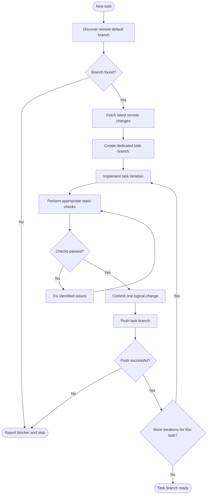
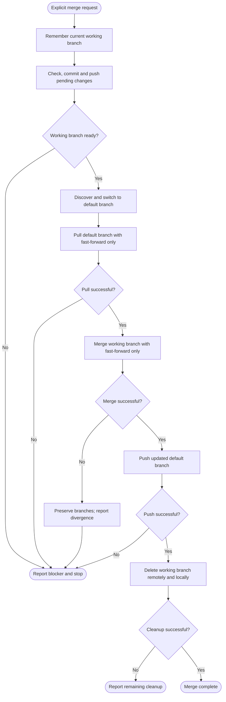
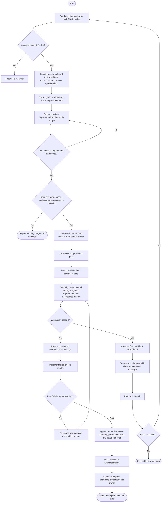

# Agent Instructions (AGENTS.md)

<!--
This file is the authoritative guide for AI agents and developers working in this repository.
It applies the single-agent workflow with repository-specific Python guidance.

Maintenance rules:
- Keep guidance conceptual and operational; avoid implementation-specific details.
- Update this file only when workflow, policy, architecture boundaries, or naming rules change.
- Do not embed large code snippets or data dumps here; reference source paths instead.
- Keep sections in the order defined below to preserve consistency.
- During normal task execution, do not modify this file unless explicitly requested.
-->

## Single-agent execution

Use one agent to plan, implement, validate, and correct work end to end.

- Perform the full workflow directly: understand requirements, plan, implement, review the actual diff, and validate.
- Keep execution focused on the active task and avoid unnecessary process overhead.
- Do not split normal work into separate implementation and reviewer roles.
- Review the actual diff yourself and use focused self-review for additional quality checks when needed. Do not spawn subagents.
- Keep work sequential, explicit, and lean.
- Do not create unnecessary coordination artifacts for simple tasks.

## Git workflow

Use this Git workflow for task branches, validation loops, and explicit merge requests.

### Conventions

- **Default branch:** The branch configured as default on the remote repository; never assume it is named `main`.
- **Task branch:** A dedicated branch for one task, created from the latest remote default branch.
- **Working branch:** The current task branch whose changes may later be merged.
- **Iteration:** One implementation or follow-up correction cycle, completed with checks, a commit, and a push.
- **Upstream:** The configured remote branch used for pulling and pushing a local branch.

Before Git operations, discover the actual default branch with `git symbolic-ref refs/remotes/origin/HEAD`.
If that reference is missing or stale, use `git ls-remote --symref origin HEAD`.
Fetch latest remote changes before creating a task branch. If the default branch cannot be determined reliably, report a blocker and stop.

### 1. Task development

#### Execution rules

1. Create a separate `codex/` branch for every new task from the latest remote default branch. Never implement task changes directly on the default branch.
2. Keep all follow-up iterations for the same task on its existing task branch.
3. After each iteration, run relevant static checks and inspect actual changes before committing. Fix identified problems and re-check.
4. Create one implementation commit per completed task. Create later review/fix commits separately, one logical change per commit. Do not amend or squash unless explicitly requested.
5. Push the task branch after each completed iteration. Set upstream on first push. Committing and pushing each iteration are part of the requested work and do not require additional confirmation.
6. If branch creation, checks, commit, or push cannot complete, stop and report the blocker with current committed/uncommitted/unpushed state.

#### Commit messages

Use short, compact, non-technical messages:

`<task-slug>: <short description>`

Examples:

- `auth: add token refresh handling`
- `ui-filter: fix date sorting`
- `import: handle empty input rows`

### 2. Merge working branch into default branch

Run this only when explicitly requested (for example: "merge to default branch", "bring latest to main", "merge work to main", "integrate branch"). Such a request authorizes pushing the default branch and deleting the working branch after success.

#### Execution rules

1. Record the current working branch before switching. Verify task changes are checked, then commit and push pending changes.
2. Discover the remote default branch as defined above. Switch to its local tracking branch (create it if missing).
3. Update default branch with `git pull --ff-only`. If this fails, stop and report divergence.
4. Merge with `git merge --ff-only <working-branch>`. No merge commits, automatic rebases, force pushes, or conflict-resolution shortcuts.
5. If fast-forward merge is not possible, preserve both branches, report divergence, and stop.
6. After successful merge, push default branch, then delete working branch remotely and locally.
7. If push or cleanup fails, report exactly what succeeded and what remains.

### Shared safety rules

- Never guess default branch names or force conflicting history updates.
- Keep each commit to one logical change.
- Do not merge or delete branches without explicit authorization and successful checks.
- Preserve recoverable work; report blockers instead of destructive improvisation.

## 1. Repo structure

- `specification/` contains the authoritative product specification.
- Numbered Markdown files directly inside `tasks/` contain pending task descriptions and dependencies.
- `tasks/done/` and `tasks/incomplete/` preserve completed and incomplete tasks; `tasks/temp/` holds optional uncommitted task artifacts.
- Root-level Python modules contain the application, dashboard, parsing, analytics, and supporting features. `README.md` documents usage.

## 2. Naming conventions

- Follow PEP 8 conventions for Python code.
- Use descriptive names that clearly communicate intent.
- Use `snake_case` for modules, functions, methods, and variables.
- Use `PascalCase` for classes.
- Use `UPPER_SNAKE_CASE` for constants.
- Avoid unnecessary abbreviations and redundant names.
- Preserve existing project-specific naming conventions.

<!--
Add any additional project-specific naming rules here.
-->

## 3. Documentation and tests policy

### Documentation

- Use Google-style docstrings for Python classes and methods.
- Describe purpose, parameters, return values, and exceptions where applicable.
- Keep docstrings concise and avoid repeating information obvious from names or type hints.
- Add inline comments only when necessary to explain **why** something is implemented in a particular way.
- Document non-obvious decisions, constraints, and workarounds.
- Avoid comments that merely describe what the code does.
- Keep documentation consistent with implementation changes.

### Tests and validation

- Use agent-performed static analysis and code inspection as the primary validation method.
- Check changes against task requirements, specifications, and existing architecture.
- Inspect for logical errors, missing requirements, incorrect dependencies, and unintended changes.
- Do not create or modify unit tests unless explicitly requested.
- Do not introduce testing frameworks or additional testing infrastructure.
- Existing project tests and static analysis tools may be executed when available and relevant.
- Verify modified code imports and executes correctly when applicable.
- Do not require new automated tests for task completion.
- Do not claim successful validation without performing the relevant checks.

### Specification protection

- Treat specifications as authoritative requirements.
- Do not modify specifications unless explicitly required by the current task.
- Do not modify specifications to justify implementation differences.
- If implementation and specifications disagree, correct the implementation or report the conflict.
- Do not update `AGENTS.md` during ordinary task execution unless explicitly requested.

## 4. How-to

### General implementation guidance

#### Principles

- Follow existing architecture and conventions.
- Prefer simple, clear, maintainable solutions.
- Avoid overengineering and speculative abstractions.
- Keep responsibilities focused and dependencies minimal.

#### Changes and refactoring

- Make the smallest change that fully satisfies the task.
- Preserve existing behavior unless change is explicitly required.
- Avoid unrelated refactors and unrelated cleanup.
- Reuse existing utilities/components when appropriate.
- Avoid changing public interfaces unless required.

### Sequential task execution

When asked to execute tasks from `tasks/`, follow this workflow.

#### 1. Purpose and scope

Execute numbered Markdown tasks from `tasks/` one at a time, in numeric-prefix order, until all tasks are completed or execution is blocked.

#### 2. Terms and conventions

| Term | Convention |
|---|---|
| Pending task | A numbered `.md` file directly inside `tasks/`; exclude `README.md` and other supporting documents. |
| Task filename | A numeric prefix followed by a short description (for example, `15-remove-source-changes.md`). Preserve existing filenames and sort by numeric prefix. |
| Completed task | A verified task moved to `tasks/done/`, retaining filename. |
| Incomplete task | A task moved to `tasks/incomplete/` after five failed verification checks, retaining filename and issue history. |
| Issue Logs | Append-only section at the bottom of the task file; original task content remains unchanged. |
| Verification check | Model-performed static inspection of real changes against requirements and acceptance criteria. |
| Failed check | Verification check that finds unresolved issues; count up to five per task. |
| Temporary files | Optional task-specific artifacts in `tasks/temp/`; never commit them. |

Ignore `tasks/done/`, `tasks/incomplete/`, `tasks/temp/`, and supporting documents when discovering pending tasks. Consult `tasks/README.md` for order and dependencies if present.
If task order is ambiguous (for example missing/duplicate numeric prefixes), report and stop.

#### 3. Workflow

#### 4. Execution steps

| Step | Required inputs | Action and expected output |
|---|---|---|
| Discover | `tasks/*.md` | Select lowest-numbered pending task; if none, report no tasks remain. |
| Prepare | Selected task, instructions, relevant specifications, existing implementation | Extract requirements and produce a scope-limited plan. Stop and report dependencies on unmerged work. |
| Branch | Repository default branch policy and previous task state | Create one dedicated branch for selected task. |
| Implement | Task and scope-limited plan | Make only required implementation changes. |
| Verify | Actual changes, original task, acceptance criteria | Inspect statically and determine pass/fail. |
| Record and fix | Failed verification findings and existing `Issue Logs` | Append findings before fixing, then verify again. |
| Complete | Passing verification and task changes | Move task to `tasks/done/`, commit, and push. |
| Release incomplete | Five failed checks and accumulated findings | Append final diagnosis, move task to `tasks/incomplete/`, commit, push, report failure, and stop. |

When an issue is found, append a new entry under `## Issue Logs` (create if missing).
Each entry includes: failed-check number, observed problem with file/location evidence, violated requirement/criterion, and proposed correction.
Keep prior entries intact. On the fifth failure, append a final unresolved summary.

#### 5. Execution guardrails

- Strictly sequential execution; do not run multiple tasks concurrently.
- Never rewrite task requirements or acceptance criteria to fit implementation.
- Change only files required for the selected task.
- Do not create new test frameworks/infrastructure for this workflow.
- Record every failed check; stop after the fifth failed check.
- Write findings before fixes; do not remove earlier findings.
- Keep branch isolation: one task per branch, created from the latest remote default branch. Before starting the next task, confirm required earlier changes and task-file moves are present there. If integration is pending, report the dependency and stop; do not merge automatically.
- Never force-push or bypass divergence with unsafe Git operations.
- Remove safe-to-remove temporary artifacts in `tasks/temp/` after completion.
- Keep status reporting concise and operational.

#### 6. Completion conditions

A task is done only if requirements and acceptance criteria pass static verification, the task file is moved to `tasks/done/`, and relevant changes are committed and pushed.

A task is incomplete after five failed verification checks. Preserve issue history and final diagnosis in `tasks/incomplete/`, persist state when possible, report blockers, and stop.

When no pending task files remain in `tasks/`, report: **No tasks left.**

## 5. Project-specific extensions

### Python implementation

#### General principles

- Follow existing project conventions, architecture, and specifications.
- Prefer simple, readable, and maintainable solutions.
- Apply low coupling and high cohesion.
- Follow the single responsibility principle.
- Prefer explicit, straightforward code over clever implementations.
- Avoid overengineering, unnecessary abstractions, and speculative functionality.
- Avoid code duplication, but do not introduce abstractions for trivial or isolated cases.

#### Code organization

- Organize code into modules with clear responsibilities.
- Use classes to encapsulate related state and behavior.
- Keep classes focused and reasonably small.
- Prefer composition over inheritance.
- Use constructor-based dependency injection where appropriate.
- Minimize dependencies between modules and classes.
- Keep implementation details private unless external access is required.
- Do not introduce interfaces, base classes, factories, or design patterns without a concrete need.

#### Changes and refactoring

- Make the smallest necessary changes to satisfy the task.
- Preserve existing behavior unless explicitly required otherwise.
- Do not refactor unrelated code.
- Do not introduce new dependencies unless necessary.
- Reuse existing components and utilities where appropriate.
- Avoid changing public interfaces unless required.
- Remove obsolete code introduced by the current change, but avoid unrelated cleanup.
- Modify only files relevant to the task.
