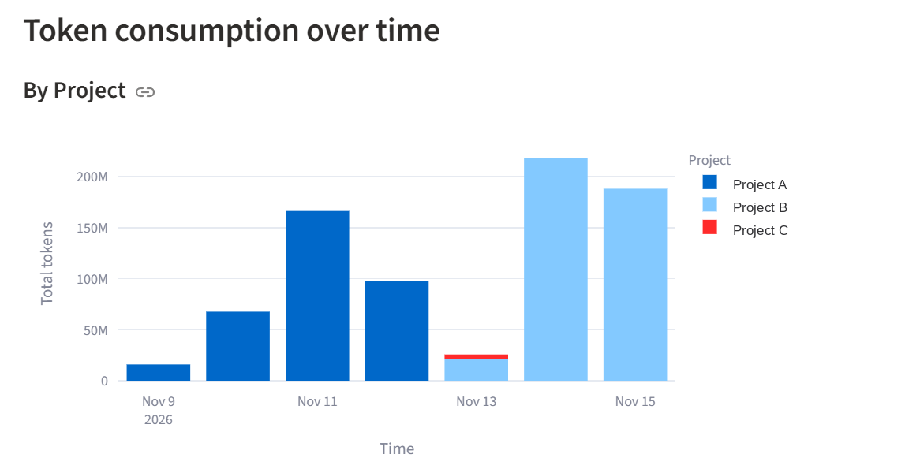
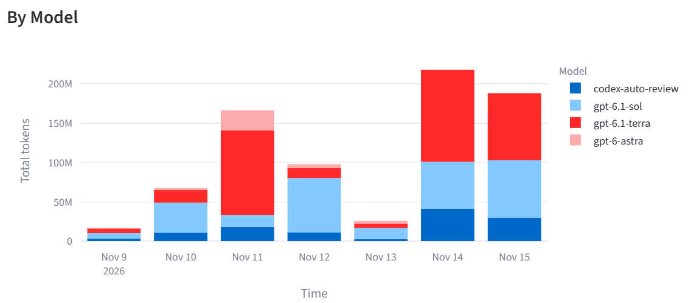
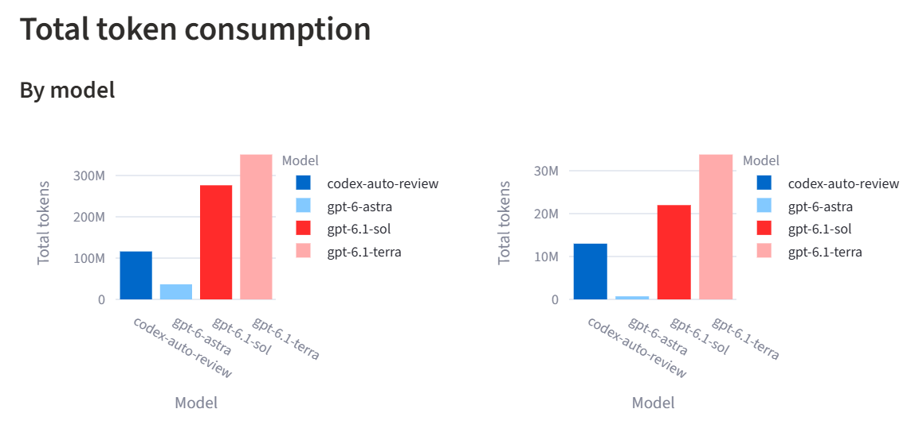

# Codex Usage Analyzer

A local Windows dashboard for exploring Codex token usage and agent activity.

> [!IMPORTANT]
> The analyzer calculates usage statistics from the local Codex app’s session logs. Codex web usage is excluded.

## Data sources

The app imports local JSONL logs from `%USERPROFILE%\.codex\sessions` and `%USERPROFILE%\.codex\archived_sessions` into SQLite. Edit `config.toml` to change the source folders.

## Dashboard

The Streamlit dashboard shows token totals and cache metrics in a summary table. Interactive charts break down totals and trends by project, model, and agent. Choose an hourly, daily, weekly, or monthly view and filter by date, project, model, agent role, chat, or agent.

<p>
  
  
</p>

Choose a date range and turn on **Compare to previous period** to compare it with the immediately preceding range of the same length. The summary table adds previous-period values, and charts show the selected period on the left and the previous period on the right, using the same filters and time aggregation.



## Run locally

Install Python 3.12 on Windows and add it to PATH. Run these commands from the project folder.

```powershell
python -m venv .venv
.\.venv\Scripts\python.exe -m pip install -r requirements.txt
.\run.bat
```

Open [http://localhost:8501](http://localhost:8501).
