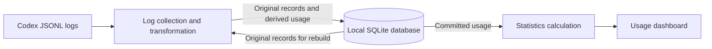

# System overview

The Codex Usage Analyzer is a local Windows application for understanding token usage, agent activity, and the efficiency of different execution configurations. Users can analyze usage by time, project, model, or agent. Session and thread IDs remain internal evidence for attribution and traceability. The application works offline without Codex authentication, API access, or external services. It keeps a local copy of the logs so usage can be rebuilt after the source files move or disappear.

## Core concepts

- A **session** is a Codex conversation identified by its session ID. It can contain several user requests, execution phases, and agent threads.
- An **agent thread** identifies one execution. The **main agent** may act as an orchestrator. **Subagents** are agents started by the main agent. See [agent analysis](./020-backend-class-design.md#agent-analysis) and the [thread data model](./010-usage-data-model.md#codexagentthread).

## System components

Collection and reporting run in the same application process and share one local database.

## Data sources

Read JSONL files from `%USERPROFILE%\.codex\sessions`, `%USERPROFILE%\.codex\archived_sessions`, and additional configured directories. Extract session identity, project path, timestamps, model and reasoning effort, agent identity and available parent, role and nickname, token counters, coordination events, and recorded skill invocations. Use event evidence to identify skill or subagent activity. Conversation text alone is insufficient.

## Component behavior

| Area | Behavior |
| --- | --- |
| Log collection | On first use and refresh, scan configured active and archived logs read-only. Store every line byte for byte, including malformed, unknown, and unterminated lines. Raw records can contain prompts, instructions, or tool output. |
| Log continuity | Identify lines by log identity and line number. Reuse records for unchanged logs and verified archive moves. Check the stored byte prefix before appending or completing a line and keep its ID and captured bytes. Assign a new identity to rewrites or truncations that fail this check. Retain previously collected records even if files disappear. |
| Usage rebuild | After collection or on rebuild, run the same transformations over one committed, source-ordered snapshot. Report malformed, incomplete, or unsupported data and carry known affected times and threads into coverage. The same records and rules produce the same results. |
| Local storage | Commit each source's raw changes in one transaction. Publish derived usage, threads, and coverage diagnostics in a separate transaction. Report missing directories and continue with available data. If reading, transformation, or writing fails, report it and retain the last committed usage and raw records for retry. Preserve raw records, saved markers, and user-authored data across rebuilds and schema upgrades. Keep stable session and event references and save annotation files atomically. |
| Statistics and dashboard | Recalculate from committed derived data when filters change. Apply the [token accounting rules](./020-backend-class-design.md#token-accounting) before filtering or grouping usage. |

## Local deployment

Use Python with pandas for analysis, Streamlit and Plotly for the dashboard, and SQLite for collected and derived data. Keep the application self-contained, with local JSON for existing user metadata. Bind the dashboard to `http://localhost:8501` and disable telemetry. Provide `setup.bat` for installation and `run.bat` to start the application.

[Usage data model](./010-usage-data-model.md) · [Backend class design](./020-backend-class-design.md) · [Dashboard behavior](../../01-screens/030-content.md)
