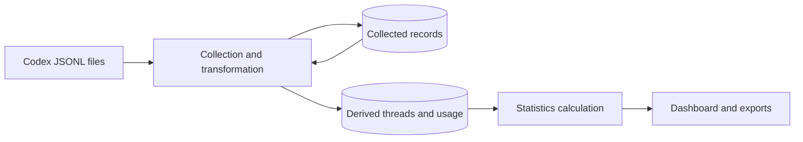

# Usage analytics backend

The backend preserves local Codex logs in SQLite and transforms the collected records into a dataset for the [usage views](../../codex-usage-analyzer.md#6-bi-dashboard). First use and source refresh collect records and run the registered transformations. A dashboard filter change calculates statistics from the last committed dataset.

Collection and reporting use the same local SQLite database and run in the application process. See the [data model](./010-usage-data-model.md) for persisted records and measurement results, and the [backend class design](./020-backend-class-design.md) for responsibilities and dependencies.

## Raw collection

`CodexLogImporter` reads configured active and archived logs without modifying them. It collects every line, including unknown event types, malformed records, and an unterminated final line. Original bytes are stored locally and may contain prompts, instructions, or tool output. Reports and CSV exports use derived data.

Use the log identity and line number to distinguish records, including identical lines at different positions. An unchanged log or a verified copy moved to the archive reuses the collected records. Verify continuity from the collected byte prefix before adding new lines or completing a previously unterminated line. A completed line keeps the original record ID and every previously captured byte. Path or file size alone is insufficient to establish continuity. When a source is rewritten or truncated and continuity cannot be established, collect it under a separate identity and retain the previous bytes. Missing source files leave collected records available. A full scan on refresh is sufficient initially.

Commit each source's new or extended records in one transaction. A read or write failure leaves previously committed records available and produces a diagnostic. A missing configured directory is reported. A refresh may proceed with the other configured directories and the records already collected. If a discovered source fails to read or commit, keep the last committed usage dataset and report the failure.

## Usage rebuild and accounting

1. `CodexLogImporter` runs the same registered transformations after source collection or during a rebuild from SQLite alone. Each transformation sees the same consistent snapshot of collected records in source order. The transformations parse recognized records and report malformed, incomplete, or unsupported data while retaining the original bytes. Carry known affected times and threads into report coverage.
2. Resolve counter ownership before calculating deltas. Prefer the explicit owner on a usage record. A legacy record can inherit the source thread when it has an unambiguous owner. Retain diagnostics for conflicts and keep ambiguous usage out of verified agent totals. Coordination records can identify another thread as their target.
3. Use the per-response `usage` fields of supported `token_usage_record` rows. Deduplicate by `(thread_id, response_id)` when both IDs are known. Copied or inherited history belongs to its original owner when that owner can be verified. Turn and thread counters summarize the same usage. For legacy records, calculate deltas from one cumulative stream per owner, using the preceding observation even when it falls outside the requested reporting window. Use legacy deltas alongside per-response rows only when their usage is demonstrably disjoint. For overlapping source versions, count usage only once where identity is verified and report uncertain coverage otherwise. Preserve unknown fields and report partial coverage for gaps, resets, conflicting records, or uncertain attribution.
4. Publish all registered outputs, including derived usage, threads, and associated coverage diagnostics, in one transaction. A failed transformation or database write leaves the last committed usage dataset available. Successfully collected records remain available for a retry. Retain collected records, saved time markers, and existing annotations across rebuilds and schema upgrades. Rebuilding the same records with the same rules produces the same results.

Cross-thread totals include only independently attributable usage. If some usage is missing or its scope may overlap, report the known independent amount as partial when it can be stated reliably, or report unknown. Apply the same rule to charts, tables, and CSV exports.
