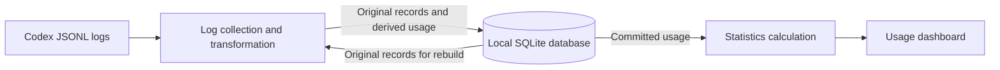

# System overview

The Codex Usage Analyzer reads local Codex logs and reports token usage by project, model, and agent in a dashboard. It keeps a local copy of the logs so usage can be rebuilt after the source files move or disappear.

Collection runs on first use and source refresh. Dashboard filters recalculate statistics from the committed data. Collection and reporting run in the same application process and use the same local database.

[Usage data model](./010-usage-data-model.md) · [Backend class design](./020-backend-class-design.md) · [Collection and accounting rules](./030-collection-and-accounting.md)
