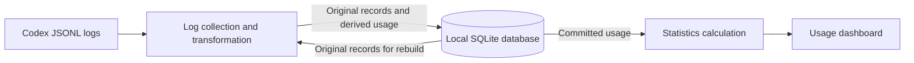

# System overview

The Codex Usage Analyzer reads local Codex logs and reports token usage by project, model, and agent in a dashboard. It keeps a local copy of the logs so usage can be rebuilt after the source files move or disappear.

Collection and reporting run in the same application process and share one local database.

## Component behavior

| Area | Behavior |
| --- | --- |
| Log collection | On first use and refresh, scan configured active and archived logs read-only. Store every line byte for byte, including malformed, unknown, and unterminated lines. Raw records can contain prompts, instructions, or tool output. |
| Log continuity | Identify lines by log identity and line number. Reuse records for unchanged logs and verified archive moves. Check the stored byte prefix before appending or completing a line and keep its ID and captured bytes. Assign a new identity to rewrites or truncations that fail this check. Retain previously collected records even if files disappear. |
| Usage rebuild | After collection or on rebuild, run the same transformations over one committed, source-ordered snapshot. Report malformed, incomplete, or unsupported data and carry known affected times and threads into coverage. The same records and rules produce the same results. |
| Token accounting | Resolve ownership first. Prefer explicit owners, use the source thread for unambiguous legacy records, and attribute verified copied or inherited history to its original owner. Coordination records may target another thread. Use per-response usage where supported and deduplicate by thread and response IDs when both are known. Turn and thread counters summarize the same usage. Calculate legacy deltas from one cumulative stream per owner. Use the prior observation even outside the report window and keep its timestamp when known. Combine legacy and response usage only for disjoint scopes. |
| Attribution | Match model and project context by thread and turn IDs when available. Keep the source working directory, attribute project by turn directory with thread directory as fallback, and group by normalized repository identity or directory. Show missing attribution as unknown. Group threads by session where supported and executions across chats by agent name or role. Use nicknames to identify individual executions. |
| SQLite storage | Commit each source's raw changes in one transaction. Publish derived usage, threads, and coverage diagnostics in a separate transaction. Report missing directories and continue with available data. If reading, transformation, or writing fails, report it and retain the last committed usage and committed raw records for retry. Preserve raw records, saved markers, and annotations across rebuilds and schema upgrades. |
| Statistics and dashboard | Recalculate from committed derived data when filters change. Use provenance to count verified usage once and exclude ambiguous ownership from verified agent totals. For gaps, resets, conflicts, or potential overlap, report the reliable independent amount as partial or the total as unknown. Keep unavailable token counts unknown. |

[Usage data model](./010-usage-data-model.md) · [Backend class design](./020-backend-class-design.md)
