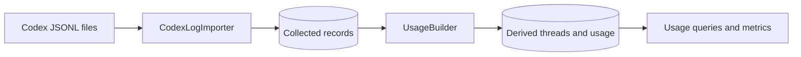

# Usage analytics backend

The backend preserves local Codex logs in SQLite and builds the dataset for the [usage views](../../codex-usage-analyzer.md#6-bi-dashboard) from the collected records. A dashboard filter change queries the last committed usage dataset. A source refresh collects records and then rebuilds usage.

`UsageStore` reads and writes the local SQLite database for both stages. The dashboard uses the store for saved time markers. All components run in the application process.

## Data model

| Record | Stored data |
| --- | --- |
| `CollectedCodexRecord` | Stable record ID, source log identity, source path at collection, line number, exact original line bytes including its terminator when present, and collection timestamp. The source log identity survives a verified append or archive move. |
| `AgentThread` | Execution identity, native thread ID, session ID, parent thread identity when verified, and observed agent name, role, or nickname when available. |
| `Usage` | Stable usage identity, owning thread when verified, observed timestamp, project key and display label when known, model when supported by the matched context, nullable input, output, cached input, cache-write input, reasoning output, and total token counts, coverage, and a reference to the collected record. Legacy deltas also retain the prior observation time when known. |
| `TimeMarker` | Stable identifier, user-entered name, and timestamp. |

One usage row represents a reported response or one legacy counter delta. Preserve `session_id` and `thread_id` separately. A verified parent link is optional, including for a thread whose parent was omitted from the import. Use the configured agent name or role to group executions across chats. A nickname can identify an individual execution in the UI. Missing project, model, or agent attribution remains visible as unknown.

Match turn context by thread and turn ID where available. Derive project attribution from that turn's working directory, with the owning thread's working directory as a fallback. Use a normalized repository identity where the metadata supports it so worktrees of the same repository group together. Use the normalized working directory when a repository identity is unavailable. Retain the source working directory for inspection.

Store timestamps in UTC and apply the dashboard time zone for date selection and display. Store observations at their original granularity so any saved timestamp can be used as a cutoff. Compute report totals and averages from usage rows when queried. The initial schema needs no project, model, conversation, or precomputed summary tables. Session ID supports conversation grouping where the source establishes it.

## Raw collection

`CodexLogImporter` reads configured active and archived logs without modifying them. It collects every line, including unknown event types, malformed records, and an unterminated final line. Original bytes are stored locally and may contain prompts, instructions, or tool output. Reports and CSV exports use derived data.

Use the log identity and line number to distinguish records, including identical lines at different positions. An unchanged log or a verified copy moved to the archive reuses the collected records. Verify continuity from the collected byte prefix before adding new lines or completing a previously unterminated line. A completed line keeps the original record ID and every previously captured byte. Path or file size alone is insufficient to establish continuity. When a source is rewritten or truncated and continuity cannot be established, collect it under a separate identity and retain the previous bytes. Missing source files leave collected records available. A full scan on refresh is sufficient initially.

Commit each source's new or extended records in one transaction. A read or write failure leaves previously committed records available and produces a diagnostic. A missing configured directory is reported. A refresh may proceed with the other configured directories and the records already collected. If a discovered source fails to read or commit, keep the last committed usage dataset and report the failure.

## Usage rebuild and accounting

1. `UsageBuilder` reads a consistent snapshot of the collected records in source order. It parses recognized records and reports malformed, incomplete, or unsupported data while retaining the original bytes. Carry known affected times and threads into report coverage. A rebuild can run without accessing the original log folders.
2. Resolve counter ownership before calculating deltas. Prefer the explicit owner on a usage record. A legacy record can inherit the source thread when it has an unambiguous owner. Retain diagnostics for conflicts and keep ambiguous usage out of verified agent totals. Coordination records can identify another thread as their target.
3. Use the per-response `usage` fields of supported `token_usage_record` rows. Deduplicate by `(thread_id, response_id)` when both IDs are known. Copied or inherited history belongs to its original owner when that owner can be verified. Turn and thread counters summarize the same usage. For legacy records, calculate deltas from one cumulative stream per owner, using the preceding observation even when it falls outside the requested reporting window. Use legacy deltas alongside per-response rows only when their usage is demonstrably disjoint. For overlapping source versions, count usage only once where identity is verified and report uncertain coverage otherwise. Preserve unknown fields and report partial coverage for gaps, resets, conflicting records, or uncertain attribution.
4. Replace derived usage, threads, and associated coverage diagnostics in one transaction. A failed rebuild leaves the last committed usage dataset available. Retain collected records, saved time markers, and existing annotations across rebuilds and schema upgrades. Rebuilding the same records with the same rules produces the same results.

Cross-thread totals include only independently attributable usage. If some usage is missing or its scope may overlap, report the known independent amount as partial when it can be stated reliably, or report unknown. Apply the same rule to charts, tables, and CSV exports.

## Backend responsibilities

| Component | Responsibility and relationship to existing code |
| --- | --- |
| `CodexLogImporter` | Discover source logs and collect original lines with provenance. Handle append, archive moves, and source changes before handing records to `UsageStore`. |
| `parser.py` and `Event` | Parse collected lines and normalize event timestamps, native IDs, counters, context, and relationship evidence. Keep parsing independent of SQLite and the dashboard. |
| `analytics.py` and `agents.py` | Use functions for usage normalization, counter arithmetic, and thread resolution. Evolve `Increment` to carry per-response amounts and legacy deltas with provenance. Evolve `Agent` to represent the resolved thread identity. Use the same resolved owner for accounting and hierarchy. |
| `UsageBuilder` | Coordinate a rebuild by reading collected records, calling the parser and accounting functions, and publishing derived threads, usage, and diagnostics through `UsageStore`. |
| `UsageStore` | Own SQLite schema setup and versioned upgrades, raw collection writes and reads, transactional replacement of derived data, filtered usage reads, and time marker persistence. Use one concrete store with Python's `sqlite3`. |
| `metrics.py`, `Filters`, and `Metrics` | Query and summarize one consistent set of usage rows for the selected filters and groupings. Apply the [reporting window rules](../../codex-usage-analyzer.md#63-visualizations) and return both metric scopes when a marker is selected. Reuse the same metric rules for dashboard and export. |
| `app.py` and `dashboard.py` | Wire the importer, builder, and store. Trigger collection and rebuild on refresh, and render the last committed results and diagnostics. |

Existing annotation storage continues to own session labels and other existing user metadata.
