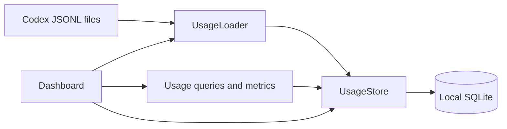

# Usage analytics backend

The backend imports local Codex logs into SQLite and reads that dataset for the [usage views](../../codex-usage-analyzer.md#6-bi-dashboard). A dashboard filter change queries the last committed import. A source refresh runs the importer.

The dashboard calls the loader for refresh, queries for reporting, and the store for saved time markers. All components run in the application process.

## Data model

| Record | Stored data |
| --- | --- |
| `AgentThread` | Execution identity, native thread ID, session ID, parent thread identity when verified, and observed agent name, role, or nickname when available. |
| `Usage` | Stable usage identity, owning thread when verified, observed timestamp, project key and display label when known, model when supported by the matched context, nullable input, output, cached input, cache-write input, reasoning output, and total token counts, coverage, and source reference. Legacy deltas also retain the prior observation time when known. |
| `TimeMarker` | Stable identifier, user-entered name, and timestamp. |

One usage row represents a reported response or one legacy counter delta. Preserve `session_id` and `thread_id` separately. A verified parent link is optional, including for a thread whose parent was omitted from the import. Use the configured agent name or role to group executions across chats. A nickname can identify an individual execution in the UI. Missing project, model, or agent attribution remains visible as unknown.

Match turn context by thread and turn ID where available. Derive project attribution from that turn's working directory, with the owning thread's working directory as a fallback. Use a normalized repository identity where the metadata supports it so worktrees of the same repository group together. Use the normalized working directory when a repository identity is unavailable. Retain the source working directory for inspection.

Store timestamps in UTC and apply the dashboard time zone for date selection and display. Store observations at their original granularity so any saved timestamp can be used as a cutoff. Compute report totals and averages from usage rows when queried. The initial schema needs no project, model, conversation, or precomputed summary tables. Session ID supports conversation grouping where the source establishes it.

## Import and accounting

1. Read active and archived JSONL logs and retain only the evidence needed for attribution and accounting. Keep original logs read-only.
2. Resolve counter ownership before calculating deltas. Prefer the explicit owner on a usage record. A legacy record can inherit the source thread when it has an unambiguous owner. Retain diagnostics for conflicts and keep ambiguous usage out of verified agent totals. Coordination records can identify another thread as their target.
3. Use the per-response `usage` fields of supported `token_usage_record` rows. Deduplicate by `(thread_id, response_id)` when both IDs are known. Copied or inherited history belongs to its original owner when that owner can be verified. Keep source references independent of file location. Turn and thread counters summarize the same usage. For legacy records, calculate deltas from one cumulative stream per owner, using the preceding observation even when it falls outside the requested reporting window. Use legacy deltas alongside per-response rows only when their usage is demonstrably disjoint. Preserve unknown fields and report partial coverage for gaps, resets, conflicting records, or uncertain attribution.
4. Replace imported usage and thread rows together in a transaction after a successful scan. Refreshing the same inputs or moving a file to the archive leaves usage totals unchanged. A failed scan or database write leaves the previous import available. Individual malformed or incomplete records can be skipped. Keep their diagnostics with the import and carry any known affected time or thread into report coverage. A rebuild preserves saved time markers and existing annotations.

Import uses a full scan initially. SQLite holds normalized usage and thread metadata. Original logs retain the underlying observations. Cross-thread totals include only independently attributable usage. If some usage is missing or its scope may overlap, report the known independent amount as partial when it can be stated reliably, or report unknown. Apply the same rule to charts, tables, and CSV exports.

## Backend responsibilities

| Component | Responsibility and relationship to existing code |
| --- | --- |
| `parser.py` and `Event` | Discover and read Codex JSONL. Normalize event timestamps, native IDs, counters, context, and relationship evidence. Keep parsing independent of SQLite and the dashboard. |
| `analytics.py` and `agents.py` | Use functions for usage normalization, counter arithmetic, and thread resolution. Evolve `Increment` to carry per-response amounts and legacy deltas with provenance. Evolve `Agent` to represent the resolved thread identity. Use the same resolved owner for accounting and hierarchy. |
| `UsageLoader` | Coordinate one import by calling the parser and accounting functions, then hand the result and diagnostics to `UsageStore`. Own refresh orchestration. |
| `UsageStore` | Own SQLite schema setup, transactional import replacement, filtered usage reads, and time marker persistence. Use one concrete store. A Python-defined schema can use `sqlite3` directly. Keep schema upgrades versioned so user-authored markers survive them. |
| `metrics.py`, `Filters`, and `Metrics` | Query and summarize one consistent set of usage rows for the selected filters and groupings. Apply the [reporting window rules](../../codex-usage-analyzer.md#63-visualizations) and return both metric scopes when a marker is selected. Reuse the same metric rules for dashboard and export. |
| `app.py` and `dashboard.py` | Wire the loader and store, trigger refresh, and render the results and diagnostics. |

Existing annotation storage continues to own existing labels and other user metadata. The import writes only the usage dataset. Time markers are user data stored in SQLite and are preserved independently of import replacement.
