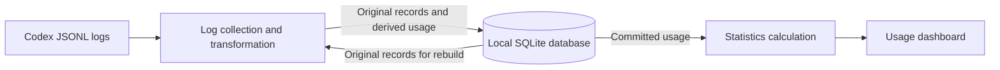

# System overview

The Codex Usage Analyzer is a local Windows application for understanding token usage, agent activity, and the efficiency of different execution configurations. Users can analyze usage by time, project, model, or agent. Session and thread IDs remain internal evidence for attribution and traceability. The application works offline without Codex authentication, API access, or external services. It keeps a local copy of the logs so usage can be rebuilt after the source files move or disappear.

## Core concepts

- A **session** is a Codex conversation identified by its session ID. It can contain several user requests, execution phases, and agent threads.
- An **agent thread** identifies one execution. The **main agent** may act as an orchestrator. **Subagents** are agents started by the main agent. See [agent analysis](./020-backend-class-design.md#agent-analysis) and the [thread data model](./010-usage-data-model.md#codexagentthread).

## System components

Collection and reporting run in the same application process and share one local database.

## Data sources

Read JSONL files from `%USERPROFILE%\.codex\sessions`, `%USERPROFILE%\.codex\archived_sessions`, and additional configured directories. Extract session identity, project path, timestamps, model and reasoning effort, agent identity and available parent, role and nickname, per-response token usage, coordination events, and recorded skill invocations. Read the Codex `session_index.jsonl` separately for chat titles, retaining index evidence for SQLite-only rebuilds. Resolve titles from the positively identified root thread and propagate them through verified parent links; missing or conflicting evidence leaves the title unknown. Use event evidence to identify skill or subagent activity. Conversation text alone is insufficient.

## Component behavior

| Area | Behavior |
| --- | --- |
| Log collection | Scan configured active and archived logs read-only. Store every line byte for byte, including malformed, unknown, and unterminated lines. Raw records can contain prompts, instructions, or tool output. |
| Incremental refresh | On first use and incremental refresh, discover sources and skip opening log files whose size and modification time match a completed read. For new, changed, and moved files, check byte continuity before completing an unfinished line, appending, or reusing a log identity. Give discontinuous rewrites or truncations a new identity. Keep previously collected records if source files disappear. |
| Full refresh from source | Read all currently available configured logs and chat-title evidence from scratch. Replace the raw archive, derived results, and source checkpoints in one publication after successful collection and transformation. Report missing roots and use available sources. If no source records can be loaded or an input read, transformation, or write fails, keep the prior dataset. |
| Usage rebuild | Run the same transformations over a source-ordered snapshot after refresh or when rebuilding from SQLite. Report malformed, incomplete, or unsupported data and carry affected times and threads into coverage. A rebuild keeps the raw archive. |
| Local storage | Commit incremental source records and checkpoints together per source. Publish derived rows, diagnostics, and the raw evidence manifest together. A failed refresh leaves the last publication available. Preserve saved markers and other user-authored data across refreshes, rebuilds, and schema upgrades. Keep stable session and event references during incremental refresh and rebuild. Save annotation files atomically. |
| Statistics and dashboard | Recalculate from committed derived data when filters change. Apply the [token accounting rules](./020-backend-class-design.md#token-accounting) before filtering or grouping usage. |

## Local deployment

Use Python with pandas for analysis, Streamlit and Plotly for the dashboard, and SQLite for collected and derived data. Keep the application self-contained, with local JSON for existing user metadata. Bind the dashboard to `http://localhost:8501` and disable telemetry. Provide `setup.bat` for installation and `run.bat` to start the application.

[Usage data model](./010-usage-data-model.md) · [Backend class design](./020-backend-class-design.md) · [Dashboard behavior](../../01-screens/030-content.md)
