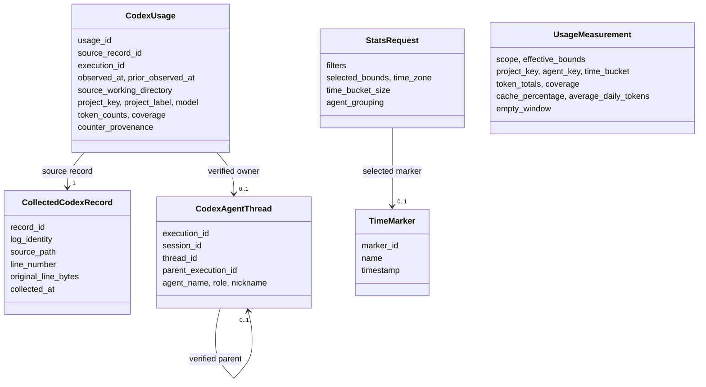

# Usage data model

SQLite stores the first four classes. Requests and measurements live in memory for each report. Store timestamps in UTC at source precision so any saved timestamp can serve as a cutoff. Use the dashboard time zone for date selection and display.

## Class overview

| Class | Description |
| --- | --- |
| `CollectedCodexRecord` | Preserves one JSONL line byte for byte, including any terminator. |
| `CodexAgentThread` | Identifies an execution by separate session and thread IDs, with an optional verified parent. |
| `CodexUsage` | Records token counts for a response or legacy counter delta. |
| `TimeMarker` | Stores a named timestamp across rebuilds and schema upgrades. |
| `StatsRequest` | Carries report filters, time range, and grouping settings. |
| `UsageMeasurement` | Summarizes usage and coverage for a reporting window or a group within it. |

`CodexUsage` has nullable input, output, cached input, cache-write input, reasoning output, and total token counts.

## Class schema

