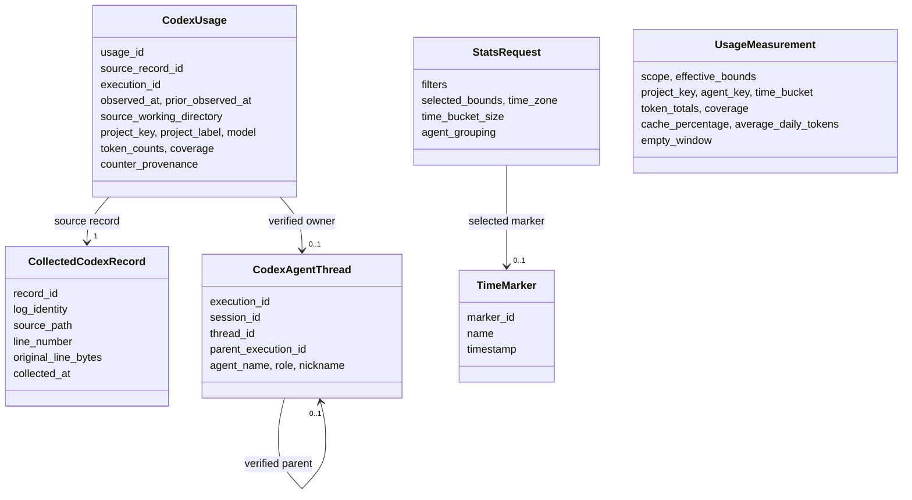

# Usage data model

SQLite stores the first four classes. Requests and measurements live in memory for each report. Store timestamps in UTC at source precision so any saved timestamp can serve as a cutoff. Use the dashboard time zone for date selection and display.

## Class overview

| Class | Description |
| --- | --- |
| `CollectedCodexRecord` | Preserves one JSONL line byte for byte, including any terminator. Log identity survives verified appends and archive moves. See [raw collection](./000-system-overview.md#raw-collection). |
| `CodexAgentThread` | Identifies an execution with separate session and native thread IDs and an optional verified parent. Group by session when the source supports it, or by name or role across chats. A nickname can identify an execution in the UI. |
| `CodexUsage` | Records a response or legacy counter delta, with provenance and coverage for potential overlap. Legacy deltas retain the prior observation time when known. Input, output, cached input, cache-write input, reasoning output, and total counts are nullable. Each row keeps the source directory. Match context by thread and turn IDs when available and take the model from matched context. Attribute project by turn directory, falling back to thread directory. Group by normalized repository identity when known, otherwise by normalized directory. Show missing project, model, or agent attribution as unknown. |
| `TimeMarker` | Stores a user-named timestamp across rebuilds and schema upgrades. See [saved time markers](../../codex-usage-analyzer.md#54-saved-time-markers). |
| `StatsRequest` | Carries report settings, including grouping by execution, name, or role. Calculators share the same filters and resolved [reporting windows](../../codex-usage-analyzer.md#63-visualizations). See [StatsCalculation](./020-backend-class-design.md#statscalculation). |
| `UsageMeasurement` | Reports an on-demand summary or group from committed rows for the full period or since the marker. Values carry complete, partial, or unknown coverage. Empty windows are explicit and unknown amounts stay distinct from zero. |

## Class schema

