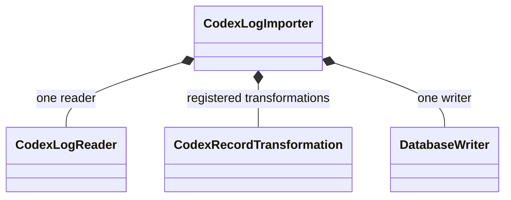
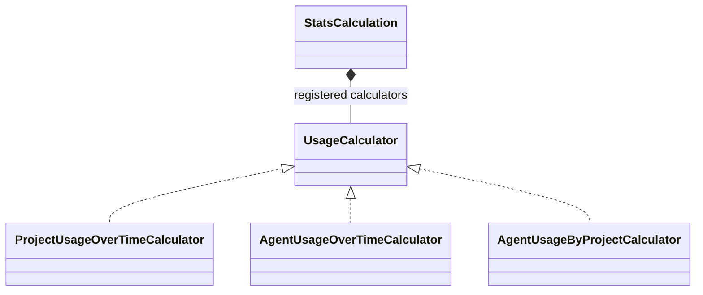

# Backend class design

The import classes implement the [collection and rebuild workflows](./000-system-overview.md). The statistics classes calculate reports from the committed [usage data model](./010-usage-data-model.md).

## Import classes

### CodexLogImporter

Receive a reader, a collection of transformations, and a writer. On a source refresh, collect original records through the reader and persist them with the writer. Then replay the committed raw snapshot through every registered transformation and publish their results together. A rebuild runs this same transformation and publication flow using SQLite as the source. The importer reports collection and transformation diagnostics and owns the decision to publish the results together.

### CodexLogReader

The file reader discovers configured files and reads original lines in source order with their byte and position information. It supplies the source evidence the importer uses to identify appends, archive moves, and source changes. A SQLite read function supplies the ordered snapshot for replay through the same reader contract. Each importer entry point receives one reader.

### CodexRecordTransformation

Each registration provides an output record type, destination mapping, and a parser that accepts an ordered snapshot of collected records and produces rows and diagnostics. The importer calls every registration through this common interface. A parser can consult multiple source records to resolve an identity, find turn context, or calculate a legacy counter delta. Register transformations for [`CodexAgentThread`](./010-usage-data-model.md#codexagentthread) and [`CodexUsage`](./010-usage-data-model.md#codexusage). Share the same identity rules and parsing helpers across both. Each transformation returns its rows to the importer for writing.

### DatabaseWriter

Use Python's `sqlite3` to write records through the supplied destination mapping and provide transaction operations. Support collected records, transformed rows, and saved markers through the same writer. Keep schema definitions and versioned upgrades with the data model's SQLite setup. The writer handles persistence and receives publication boundaries from the importer.

## Statistics classes

### StatsCalculation

Receive a [`StatsRequest`](./010-usage-data-model.md#statsrequest) and the calculators for the requested report. Resolve the reporting windows once and give each calculator the same filters, effective windows, and read snapshot. Assemble the returned [`UsageMeasurement`](./010-usage-data-model.md#usagemeasurement) objects. A report uses one committed SQLite snapshot even if an import finishes during the calculation.

### UsageCalculator

Each calculator reads the committed records it needs through the report's read connection and returns measurement objects. Use shared aggregation functions for token totals, overlap and coverage rules, weighted cache percentage, and daily averages.

| Calculator | Reads and groups |
| --- | --- |
| `ProjectUsageOverTimeCalculator` | Read `CodexUsage` and group by project and time bucket. |
| `AgentUsageOverTimeCalculator` | Read `CodexUsage` and `CodexAgentThread` and group by agent and time bucket. |
| `AgentUsageByProjectCalculator` | Read `CodexUsage` and `CodexAgentThread` and group by agent and project. |

Calculators return reporting-window summaries and grouped measurements for the requested view. Calculate summaries directly from eligible rows so percentages and overlap handling are consistent across groupings. A time-bucket measurement uses the intersection of that bucket and the reporting window as its effective bounds.

## Existing code

| Component | Responsibility |
| --- | --- |
| `parser.py` and `Event` | Parse collected lines and normalize event timestamps, native IDs, counters, context, and relationship evidence. Keep parsing independent of SQLite and the dashboard. |
| `analytics.py` and `agents.py` | Keep usage normalization, counter arithmetic, and thread resolution in functions. Evolve `Increment` to carry per-response amounts and legacy deltas with provenance. Evolve `Agent` to represent the resolved thread identity. Use the same resolved owner for accounting and hierarchy. |
| `metrics.py`, `Filters`, and `Metrics` | Reuse applicable filtering and coverage-aware aggregation in the calculators. Dashboard and export consume the same calculated measurements. |
| `app.py` and `dashboard.py` | Compose the importer and calculators. Trigger collection and rebuild on refresh. Render the last committed results and diagnostics, and read and update saved time markers. |

Existing annotation storage continues to own session labels and other existing user metadata.
