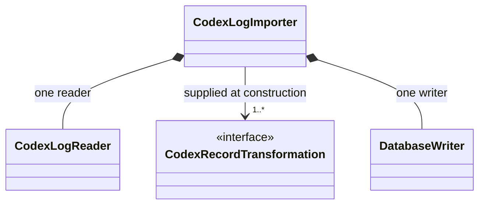
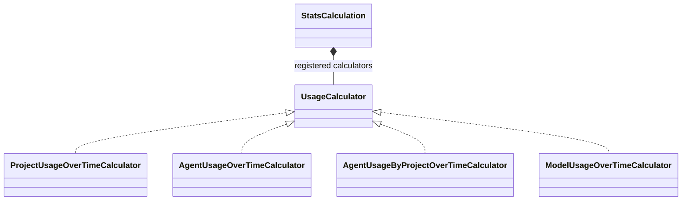

# Backend class design

## Import classes

| Class | Responsibility |
| --- | --- |
| `CodexLogImporter` | Collects and stores original records on refresh, runs registered transformations on a committed snapshot, reports diagnostics, and controls atomic publication. |
| `CodexLogReader` | Discovers configured files and yields original lines with source positions, or reads an ordered SQLite snapshot through the same interface. |
| `CodexRecordTransformation` | Abstract interface defining the methods the importer uses to obtain the output record type and destination mapping and to transform an ordered snapshot into rows and diagnostics. |
| `DatabaseWriter` | Uses Python's `sqlite3` to write collected records, transformed rows, and markers through destination mappings. |

The `CodexLogImporter` constructor receives a list of one or more objects implementing `CodexRecordTransformation`. Each implementation supplies logic specific to the data it transforms. Different classes may implement the interface. Provide implementations for [`CodexAgentThread`](./010-usage-data-model.md#codexagentthread) and [`CodexUsage`](./010-usage-data-model.md#codexusage) that share identity rules and parsing helpers.

Parsing is independent of SQLite and the dashboard. Parsers may consult multiple records for identity and turn context. Use the same resolved owner for usage accounting and agent hierarchy. The writer provides transaction operations, and the importer sets publication boundaries. Keep schema definitions and versioned upgrades with the model's SQLite setup. See [collection and rebuild](./000-system-overview.md).

## Statistics classes

| Class | Responsibility |
| --- | --- |
| `StatsCalculation` | Resolves windows once per [request](./010-usage-data-model.md#statsrequest), shares filters and one committed read snapshot, and assembles results. |
| `UsageCalculator` | Reads committed rows through the report connection and returns [measurements](./010-usage-data-model.md#usagemeasurement) using shared aggregation. |
| `ProjectUsageOverTimeCalculator` | Reads `CodexUsage` and groups by project and time bucket. |
| `AgentUsageOverTimeCalculator` | Reads `CodexUsage` and `CodexAgentThread` and groups by assigned agent name (falling back to recorded name, role, then Default) and time bucket. |
| `AgentUsageByProjectOverTimeCalculator` | Reads `CodexUsage` and `CodexAgentThread` and groups by project, reporting agent name, and time bucket. |
| `ModelUsageOverTimeCalculator` | Reads `CodexUsage` and groups by model and time bucket. |
| Whole-window model, project, and agent calculators | Group eligible rows by their respective dimension across the reporting window. The agent calculator uses the same reporting name as the agent trends. |

Dashboard and export use the same measurements. Calculate window and per-dimension summaries directly from eligible rows and clip time buckets to the reporting window. See [reporting windows](../../01-screens/030-content.md#reporting-windows).

## Agent analysis

Retain verified relationships between main agents and subagents for attribution and traceability. Agent roles and nicknames are optional metadata.

| Scope | Metrics |
| --- | --- |
| Agent | Model, observed role and verified parent when available, token consumption, cache percentage, first and last recorded activity, and available execution status. |

### Token accounting

- **Ownership.** Prefer the explicit owner and use the verified original owner for copied or inherited history. Coordination events may target another thread. Exclude ambiguous ownership from verified agent totals.
- **Counters.** Calculate token metrics only from independently attributed per-response usage. Deduplicate by verified thread and response IDs. Use the response's recorded timestamp for dates, buckets, and marker cutoffs. Keep original source lines for replay and retain observed agent metadata when response usage is unavailable.
- **Attribution.** Match model and project context by thread and turn IDs when available. Retain the source working directory. Prefer the turn's directory over the thread's directory for project attribution, and group by normalized repository identity when available or normalized directory otherwise. Group threads by session where supported. Keep unknown attribution visible where usage can be counted safely.
- **Amounts and coverage.** Track total, input, cached input, non-cached input, and output tokens, plus cache-write input and reasoning output when available. Calculate non-cached input as input minus cached input when both are known. Use provenance to count independently attributable usage once, including in main-agent and subagent rollups. For gaps, resets, conflicts, or potential overlap, report the reliable independent amount as partial or the amount as unknown. Keep unknown counts distinct from zero.
- **Rates.** Divide eligible summed cached input by eligible summed input for cache percentage. Divide the token total by elapsed days for average daily usage, including days with no recorded usage when coverage is complete. Carry the total's coverage into the daily average and leave it unknown if duration or total is unavailable.
