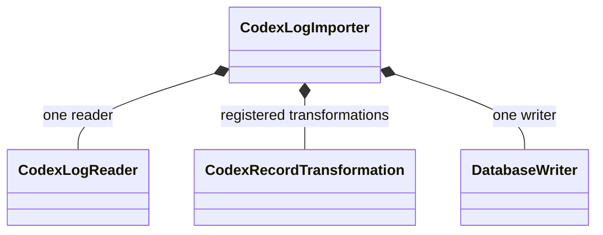
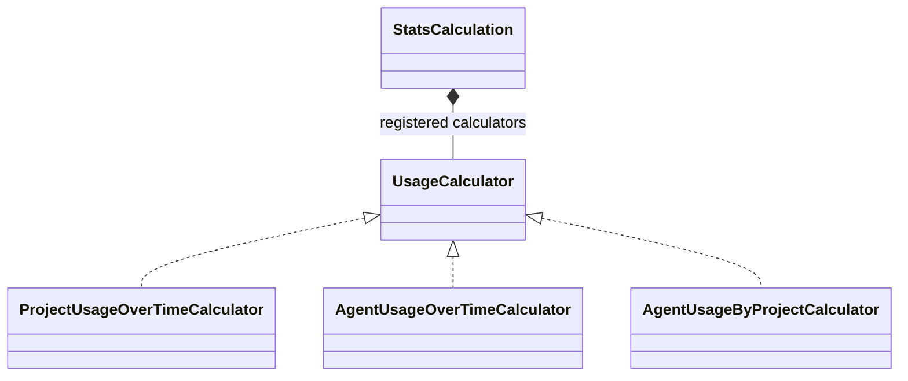

# Backend class design

## Import classes

| Class | Responsibility |
| --- | --- |
| `CodexLogImporter` | Collects and stores original records on refresh, runs registered transformations on a committed snapshot, reports diagnostics, and controls atomic publication. |
| `CodexLogReader` | Discovers configured files and yields original lines with source positions, or reads an ordered SQLite snapshot through the same interface. |
| `CodexRecordTransformation` | Defines an output type, destination mapping, and parser that turns an ordered snapshot into rows and diagnostics. |
| `DatabaseWriter` | Uses Python's `sqlite3` to write collected records, transformed rows, and markers through destination mappings. |

Register [`CodexAgentThread`](./010-usage-data-model.md#codexagentthread) and [`CodexUsage`](./010-usage-data-model.md#codexusage) through the same transformation interface and share identity rules and parsing helpers. Parsing is independent of SQLite and the dashboard. Parsers may consult multiple records for identity, turn context, or legacy deltas. Use the same resolved owner for usage accounting and agent hierarchy. The writer provides transaction operations, and the importer sets publication boundaries. Keep schema definitions and versioned upgrades with the model's SQLite setup. See [collection and rebuild](./030-collection-and-accounting.md).

## Statistics classes

| Class | Responsibility |
| --- | --- |
| `StatsCalculation` | Resolves windows once per [request](./010-usage-data-model.md#statsrequest), shares filters and one committed read snapshot, and assembles results. |
| `UsageCalculator` | Reads committed rows through the report connection and returns [measurements](./010-usage-data-model.md#usagemeasurement) using shared aggregation. |
| `ProjectUsageOverTimeCalculator` | Reads `CodexUsage` and groups by project and time bucket. |
| `AgentUsageOverTimeCalculator` | Reads `CodexUsage` and `CodexAgentThread` and groups by agent and time bucket. |
| `AgentUsageByProjectCalculator` | Reads `CodexUsage` and `CodexAgentThread` and groups by agent and project. |

Use shared rules for token totals, overlap, coverage, weighted cache percentage, and daily averages. Dashboard and export use the same measurements. Calculate window summaries directly from eligible rows. Clip time buckets to the reporting window. Mark empty windows explicitly and keep unknown amounts distinct from zero. Coverage can be complete, partial, or unknown. See [reporting windows](../../codex-usage-analyzer.md#63-visualizations).
