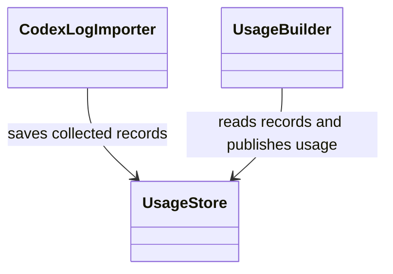

# Backend class design

The importer and builder share one concrete `UsageStore`. They implement the [collection and rebuild workflows](./000-system-overview.md) and operate on the records defined in the [usage data model](./010-usage-data-model.md).

## CodexLogImporter

Discover configured source logs and collect original lines with provenance. Handle appends, archive moves, and source changes. Hand records to `UsageStore` and report collection diagnostics. Collection works independently of the parser and token accounting.

## UsageBuilder

Read a consistent snapshot of collected records from `UsageStore`. Call the existing parsing, attribution, and accounting functions, then publish derived threads, usage, and coverage diagnostics through the store. The builder's input comes entirely from SQLite.

## UsageStore

Own SQLite schema setup and versioned upgrades, raw collection reads and writes, transactional replacement of derived data, filtered usage reads, and time marker persistence. Use Python's `sqlite3`.

## Existing code

| Component | Responsibility |
| --- | --- |
| `parser.py` and `Event` | Parse collected lines and normalize event timestamps, native IDs, counters, context, and relationship evidence. Keep parsing independent of SQLite and the dashboard. |
| `analytics.py` and `agents.py` | Keep usage normalization, counter arithmetic, and thread resolution in functions. Evolve `Increment` to carry per-response amounts and legacy deltas with provenance. Evolve `Agent` to represent the resolved thread identity. Use the same resolved owner for accounting and hierarchy. |
| `metrics.py`, `Filters`, and `Metrics` | Query and summarize a consistent set of usage rows for the selected filters and groupings. Apply the [reporting window rules](../../codex-usage-analyzer.md#63-visualizations) and return both metric scopes when a marker is selected. Reuse the same metric rules for dashboard and export. |
| `app.py` and `dashboard.py` | Wire the importer, builder, and store. Trigger collection and rebuild on refresh, and render the last committed results and diagnostics. |

Existing annotation storage continues to own session labels and other existing user metadata.
